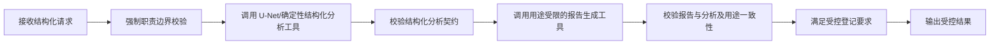

# 医院生产环境 AI 边界与策略图说明

## 1. 目标

本文用于明确当前医疗影像 AI 链路在医院生产环境中的职责边界，核心目标是：

- 严禁 LLM 代替 U-Net 或其他确定性结构化分析工具执行医学影像分析
- 严禁 LLM 生成、改写、补全正式影像分析结论
- 严禁 LLM 在结构化分析失败时“补一个像诊断一样的答案”
- 将“影像分析”和“正式报告生成”严格拆分为两个受控阶段

## 2. 角色边界

本节规定允许与禁止的职责，不表示所有能力或临床权限已经实现。当前真实入口、默认启发式限制及未完成项见第5节；规范约束不得被旧提案或界面文案替代。

### 2.1 U-Net / 结构化分析工具

允许承担的职责：

- 读取影像输入
- 执行分割或确定性分析
- 生成结构化指标
- 生成高亮区域、轮廓、边界框
- 输出正式结构化分析结果

禁止承担之外的职责：

- 不负责自由文本问答
- 不负责面向用户的自然语言扩写

### 2.2 报告生成工具

允许承担的职责：

- 严格消费结构化分析结果
- 生成正式 PDF / Markdown 报告
- 保持分析结果与报告字段一致
- 生成受控格式的图文输出

禁止承担之外的职责：

- 不自行重新推理影像
- 不凭自由文本生成分析结论

### 2.3 LLM

允许承担的职责：

- 对既有正式报告或结构化指标做说明
- 对受控输出做非诊断性的文本解释
- 对用户提问做范围提示与边界提醒

明确禁止的职责：

- 分割影像
- 生成诊断性影像分析结论
- 改写正式结构化分析结果
- 在正式分析失败时顶替 U-Net 给出“看起来像结论”的内容
- 生成未经结构化分析支撑的正式报告

### 2.4 课程科研结果与报告

课程模型包必须明确为 `research`，该用途贯穿分割结果、工具 payload 和报告；只能出具明确非诊断的科研分割报告，不能升级为临床正式报告。结构化、权重加载成功、质量门禁 PASS 或课程指标较好，都不赋予模型临床资格。

科研报告只陈述可验证的分割与几何量，不补充血流、良恶性或临床风险。无物理标定不得制造毫米测量，无校准不得填入固定临床置信度；用途或关键契约缺失时拒绝处理，而不是静默降级。具体跨语言字段由 `segmentation-service` 和 `metric-agent-harness` 定义。

## 3. 目标受控执行约束

以下是职责与校验的目标约束，不是当前Koog执行轨迹、医院上线证明或登记事务保证。当前路由直接调用受控函数，生成后由浏览器另行发起持久化；实际实现见第5节和 `med-collab-architecture`。

## 4. 策略图的强制规则

### 4.1 输入阶段

- 必须包含影像路径、模态、医院ID、患者ID、患者姓名
- 未知模态不允许进入正式分析
- 自由文本说明不能直接影响正式影像结论

### 4.2 分析阶段

- 只能由 U-Net 或其他确定性结构化分析工具输出结果
- 分析输出必须可反序列化为结构化 payload
- 分析结果必须与请求中的医院/患者/模态一致
- 分析结果若带错误信息，则禁止进入正式报告阶段

### 4.3 报告阶段

- 只能消费已经通过校验的结构化分析结果
- 报告工具不得接受兼容模式或裸分析 DTO 作为正式报告输入
- 报告中的分析ID、患者ID、医院ID必须与分析结果一致
- 报告状态必须为 `generated`
- 报告正文不能为空

### 4.4 失败阶段

- 只允许返回失败说明或人工复核提示
- 不允许触发 LLM 代替正式影像分析
- 不允许生成“基础 AI 结论”作为替代

## 5. 当前代码中的落地点

### 5.1 策略图

- `metric-service/src/main/kotlin/aiagent/strategy/StrategyGraph.kt`

策略图定义包含：

- 受控请求受理子图
- 受控结构化分析子图
- 正式报告生成子图

策略图与实际运行入口复用受控分析和报告工具函数，但实际 HTTP / WebSocket 入口直接执行 `executeControlledMetricReportPipeline`，并未运行 `metricReportStrategy` 图。图内“登记正式报告”节点当前只打印日志，不代表业务数据库登记；实际生成、确认及登记关系见 `med-collab-architecture`。

### 5.2 路由入口

- `metric-service/src/main/kotlin/Routing.kt`

当前入口行为：

- 图片分析只走受控结构化流水线
- 结构化流水线失败时，不再回退到 LLM 生成影像分析
- 文本讨论回复中明确声明 LLM 不执行分割、不生成诊断结论、不改写正式结果
- 正式报告阶段仅接收结构化分析 payload，不再接受兼容模式输入

### 5.3 分割服务对接

- `metric-service/src/main/kotlin/aiagent/tools/SegmentationServiceClient.kt`
- `metric-service/src/main/kotlin/aiagent/tools/MedicalImageAnalyzerTool.kt`

当前远程分割接收分支已对接独立 Python `segmentation-service`：

- 仅在显式启用 `METRIC_SEGMENTATION_SERVICE_ENABLED=true` 后，`metric-service` 才调用 `segmentation-service` 的 `POST /api/v1/segment`；当前默认关闭，使用本地启发式像素分析，并非默认使用已训练 U-Net
- 分割服务返回的结构化区域、质量门禁、模型摘要和工件存在信息会映射为分析 payload；research 已保留用途、包哈希及部分模型/门禁 keyIndicators，但不保留完整工件路径或原始模型响应。shared 持久化与前端转换还会进一步缩减字段，不能称为完整审计链
- 分割服务不可用、契约不匹配、质量门禁失败或无结构化区域时，链路失败并进入人工复核提示
- 不允许在分割服务失败时回退到 LLM 生成医学结论

上述规则描述远程分割启用后的接收边界，不表示默认本地启发式链路或任何已加载权重已经过医学有效性验证。确定性算法、`weights_loaded=true` 和 PDF 生成成功均不能独立证明临床可用性；已确认的指标语义限制见 `segmentation-service` 和 `metric-agent-harness`。

### 5.4 LLM 配置

- `metric-service/src/main/kotlin/Application.kt`

当前已明确：

- DeepSeek/Koog 仅为后续非诊断文本能力预留，当前文本分支只是固定范围说明，不实际调用 LLM 或绑定历史报告进行多轮解释
- 不参与正式影像分析与正式报告生成

## 6. 医院生产环境执行原则

上线前应确保以下原则被持续满足：

1. 任一正式影像分析结果都能追溯到结构化分析工具或 U-Net
2. 任一正式报告都能追溯到已校验的结构化分析结果
3. 任一 LLM 输出都不能伪装成正式影像分析结果
4. 任一分析失败都只能返回失败说明和人工复核提示
5. 任一边界变化都必须同步更新策略图、代码和测试

## 7. 最终结论

医院生产环境的边界必须是硬边界，不是提示性边界。本政策与文档同步不等于完整授权、数据/模型治理、可靠登记或临床验证已经实现；现有规范外观、PASS、CI成功或正式样式PDF不能豁免上线前置要求。

因此当前链路的原则是：

- U-Net / 结构化工具负责分析
- 报告工具负责出具正式报告
- LLM 只负责解释，不负责诊断，不负责分割，不负责补结论
